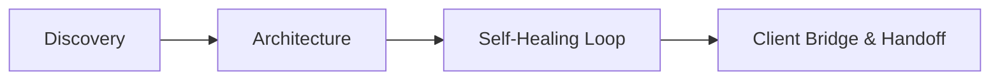

# Zero-to-Live API Architect (`zero-to-live-api`)

> Autonomous plain-English to production REST API architect for AI coding agents.

An open, portable skill conforming to the [`agentskills.io`](https://agentskills.io) specification. `zero-to-live-api` empowers coding assistants to gather requirements in plain conversational terms, scaffold edge-ready TypeScript APIs, verify and repair their own endpoints using automated tests, and provide zero-config frontend client bridges.

---

## Key Features

- **Jargon-Free Discovery:** Deduce backend models and operations from existing frontend components or through a 3-question conversational interview.
- **Production Serverless Architecture:** Scaffolds either Hono (Vercel Edge / Cloudflare Workers) or Next.js App Router route handlers with strict Zod validation, rate limiting, and CORS.
- **Autonomous Self-Healing Loop:** Runs local end-to-end verification via `scripts/verify-api.sh` and security auditing via `scripts/security-check.sh`, automatically repairing handler regressions before completing tasks.
- **One-Line Frontend Bridge:** Emits strongly typed client wrappers (`api-client.ts` / `api-client.js`) enabling single-expression UI integrations.
- **Cross-Agent Portability:** Operates identically across Claude Code, OpenAI Codex CLI, Cursor, and Google Antigravity.

---

## Directory Structure

```text
zero-to-live-api/
├── LICENSE
├── README.md
├── .gitignore
└── skills/
    └── zero-to-live-api/
        ├── SKILL.md
        ├── scripts/
        │   ├── verify-api.sh
        │   └── security-check.sh
        └── references/
            ├── hono-vercel-blueprint.md
            ├── nextjs-api-blueprint.md
            ├── frontend-bridge-template.md
            └── agensi-listing-copy.md
```

---

## Installation Across Agent Environments

### 1. Claude Code
Install to your global Claude skills directory or into your local project root:

```bash
# Global installation
mkdir -p ~/.claude/skills
cp -r skills/zero-to-live-api ~/.claude/skills/

# Project-level installation
mkdir -p .claude/skills
cp -r skills/zero-to-live-api .claude/skills/
```

### 2. OpenAI Codex CLI
Install to the standard Codex skills catalog:

```bash
mkdir -p ~/.agents/skills
cp -r skills/zero-to-live-api ~/.agents/skills/
```

### 3. Google Antigravity
Install to your local Antigravity user config:

```bash
mkdir -p ~/.gemini/config/skills
cp -r skills/zero-to-live-api ~/.gemini/config/skills/
```

### 4. Cursor
Reference the skill in your project's `.cursorrules` file or place the `skills/zero-to-live-api` folder inside your repository root:

```markdown
# .cursorrules
When requested to build, test, or scaffold an API or backend endpoints, follow the rules defined in `skills/zero-to-live-api/SKILL.md`.
```

---

## Operational Workflow



1. **Discovery:** The agent inspects frontends for inputs/forms or asks up to 3 non-technical questions to define entities and actions.
2. **Architecture:** Generates standard endpoints with Zod schema validation, unified JSON envelopes (`{ success, data, error }`), and rate limiting.
3. **Self-Healing Verification:** Executes `verify-api.sh` and `security-check.sh` locally. If any route fails or returns unexpected codes, the agent patches its code until all checks succeed.
4. **Handoff:** Generates `src/lib/api-client.ts` and `API_PLAYBOOK.md` detailing cURL commands and frontend usage.

---

## Example Usage

### Prompt:
> *"I have a React contact form in `src/components/ContactModal.tsx`. Build me a backend endpoint to receive submissions, validate email addresses, and save them."*

### Agent Action:
1. Inspects `ContactModal.tsx` and extracts input fields (`name`, `email`, `message`).
2. Creates `/api/contacts` with strict Zod validation rejecting empty messages and invalid emails.
3. Runs `verify-api.sh` to test valid submission (201), invalid submission (400), and CORS headers.
4. Generates `src/lib/api-client.ts` with `api.contacts.submit(data)`.
5. Outputs `API_PLAYBOOK.md` with copy-pasteable cURL commands.

---

## Verification & Testing Scripts

The skill bundles two standalone verification tools:

- **`scripts/verify-api.sh`**: Boots the local server (if needed), probes health endpoints, validates status codes on normal and malformed payloads, and verifies CORS headers.
  ```bash
  bash skills/zero-to-live-api/scripts/verify-api.sh 3000 endpoints.json
  ```
- **`scripts/security-check.sh`**: Scans the project for leaked secrets, committed `.env` files, missing route input validation, and insecure CORS policies.
  ```bash
  bash skills/zero-to-live-api/scripts/security-check.sh
  ```

---

## Distribution & Packaging

To create a clean distribution bundle for the Agensi.io marketplace:

```bash
mkdir -p dist/agensi
cd skills && zip -r ../dist/agensi/zero-to-live-api.zip zero-to-live-api -x "*.DS_Store" -x "*__MACOSX*" && cd ..
```

---

## Author & License

- **Author:** Chijioke Elvis Anonize
- **License:** [MIT](LICENSE)

