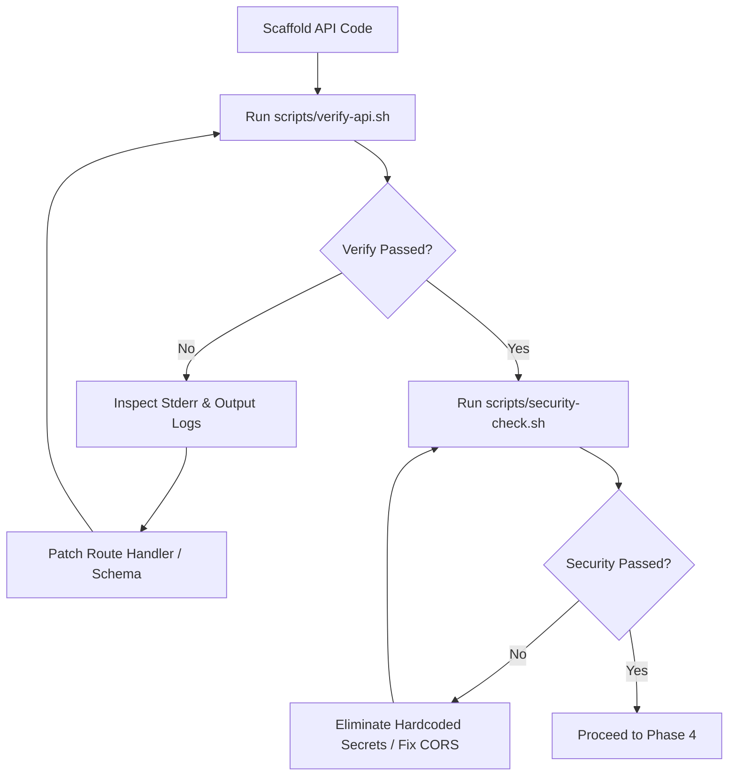

# Zero-to-Live API Architect (`zero-to-live-api`)

Autonomous protocol converting plain-English requirements into tested, hardened, serverless REST APIs with client bridges and self-healing verification.

---

## Operational Mandates

1. **Zero Jargon Rule:** Speak in plain human language (e.g., "what data should we save?" not "define entity attributes and foreign keys"). Adopt technical terminology only if the user introduces it first.
2. **Context-First Inspection:** Always inspect the local workspace for existing frontends, schemas, or configs *before* asking questions.
3. **Fail-Closed Verification:** Never declare an API ready until `scripts/verify-api.sh` and `scripts/security-check.sh` pass with exit code 0.
4. **Standard Error & Response Envelope:** Every route must return uniform JSON:
   - Success: `{ "success": true, "data": <payload> }`
   - Failure: `{ "success": false, "error": { "code": "<STRING_CODE>", "message": "<Human description>" } }`

---

## Phase 1: Plain-English Discovery Protocol

### Rule 1.1: Automated Workspace Reconnaissance
Before asking any user questions, search the workspace for:
- Form elements (`<form>`, `onSubmit`, `input`, `textarea`, `zod`, `react-hook-form`).
- Data models or types (`interface`, `type`, `prisma.schema`).
- Framework indicators: `next.config.*` (Next.js), `package.json` (Hono, Express, Vite, Svelte, Vue).

**If an existing frontend is detected:**
Extract required fields and proposed routes immediately. Present a concise proposal:
> "I found your form in `src/components/ContactForm.tsx`. I can scaffold a `/api/contacts` endpoint to save names, emails, and messages. Should I proceed or do you want extra fields?"

### Rule 1.2: The 3-Question Maximum (When No Frontend Exists)
Ask at most three plain-English questions:
1. **Data:** "What information do you want this to store or calculate? (e.g., customer waitlist, feedback, order records)"
2. **Access:** "Who should be allowed to use this? (e.g., anyone on the web, only people with an API key, or only your logged-in users?)"
3. **Actions:** "What needs to happen when someone submits or asks for data? (e.g., save it, send an email, return a calculation?)"

---

## Phase 2: Architecture & Scaffolding

### Rule 2.1: Blueprint Selection
- **Standalone API or Microservice:** Select **Hono + TypeScript + Vercel/Cloudflare**. Read and follow `references/hono-vercel-blueprint.md`.
- **Existing Next.js Project:** Select **Next.js App Router API Routes**. Read and follow `references/nextjs-api-blueprint.md`.

### Rule 2.2: Mandatory Quality & Security Baseline
All endpoints must include:
1. **Zod Validation:** Every POST, PUT, and PATCH endpoint must validate incoming JSON using strict Zod schemas with human-readable error messages.
2. **Standardized Status Codes:**
   - `200 OK`: Successful read or update.
   - `201 Created`: Successful creation.
   - `400 Bad Request`: Validation failure (field-level issues in `error.details`).
   - `401 Unauthorized` / `403 Forbidden`: Missing or invalid credentials.
   - `404 Not Found`: Entity missing.
   - `429 Too Many Requests`: Rate limit reached.
   - `500 Internal Server Error`: Uncaught exceptions handled by global error middleware.
3. **CORS Headers:** Explicit allowed origins, headers (`Content-Type`, `Authorization`), and methods. Never allow wildcard `*` if credentials/cookies are enabled.
4. **Rate Limiting:** Protect public endpoints against abuse with IP-based rate limiting (100 req/minute default).

---

## Phase 3: Autonomous Self-Healing Verification Loop

You must execute the bundled test scripts and fix all regressions autonomously without bothering the user.



### Rule 3.1: Execution Steps
1. Make scripts executable: `chmod +x skills/zero-to-live-api/scripts/*.sh` (or relative path in target environment).
2. Prepare a test endpoints JSON manifest:
   ```json
   [
     {"method": "GET", "path": "/health", "expectedStatus": 200},
     {"method": "POST", "path": "/api/items", "validPayload": {"name": "Test"}, "expectedStatus": 201},
     {"method": "POST", "path": "/api/items", "validPayload": {}, "expectedStatus": 400}
   ]
   ```
3. Run verification:
   `bash skills/zero-to-live-api/scripts/verify-api.sh 3000 endpoints.json`
4. Run security audit:
   `bash skills/zero-to-live-api/scripts/security-check.sh`

### Rule 3.2: Self-Healing Remediation Protocol
- If an endpoint returns unexpected status code (e.g. 500 instead of 400 or 201), inspect the log output.
- Check: missing JSON body parser, unhandled Zod throw, missing environment variables, or port collisions.
- Apply surgical edits to the handler code.
- Repeat until both scripts report 100% PASS (exit code 0). Max 3 autonomous healing cycles before asking user for environment-specific input.

---

## Phase 4: Frontend Bridge & Cloud Handoff

### Rule 4.1: Zero-Config Client Bridge
Generate a typed, zero-dependency client in the user's project (e.g., `src/lib/api-client.ts` or `public/api-client.js`). Follow `references/frontend-bridge-template.md`.
The client must:
- Detect local dev URL vs production URL automatically.
- Provide typed methods matching created endpoints (e.g., `api.feedback.submit(data)`).
- Throw a clean `ApiClientError` on failure with message and code.

### Rule 4.2: Deployment Configuration
Generate production configuration files:
- `vercel.json` for serverless deployment on Vercel Edge / Node runtime.
- `wrangler.toml` if deploying to Cloudflare Workers.
- Include `.env.example` with documented environment keys (never raw secrets).

### Rule 4.3: The API Playbook (`API_PLAYBOOK.md`)
Create an `API_PLAYBOOK.md` in the project root containing:
1. **Interactive Endpoint Map:** Route, Method, Sample Request payload, Sample Response payload.
2. **1-Line Frontend Example:** Show how to import `api` and trigger the endpoint.
3. **cURL Commands:** Copy-pasteable terminal commands to test live endpoints.
4. **Deploy Command:** Single terminal command (e.g., `npx vercel deploy` or `npx wrangler deploy`).
